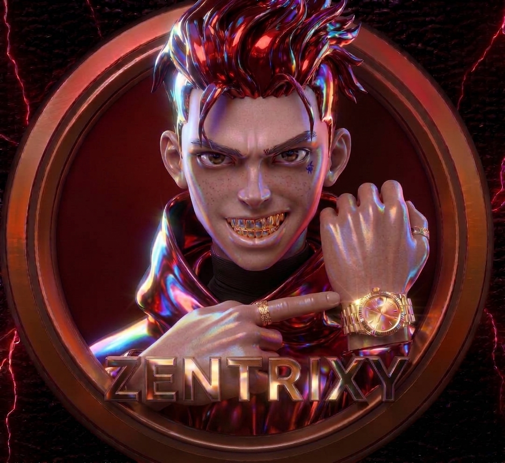

# ZENTRIXY-XMD

  <!-- Picha yako ya ZENTRIXY ikiwa katikati kwa muundo wa duara na mng'ao wa kijani -->
  <!-- Kumbuka kubadilisha "WEKA_LINK_YA_PICHA_YAKO_HAPA" na link halisi ya picha yako ya GitHub -->
  

  <!-- Mstari wa juu unaowaka na kufifia -->
  

  <!-- Sehemu ya Typing SVG yenye width na height iliyoongezwa kiasi cha kutosha -->
  

